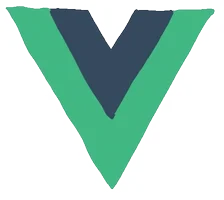
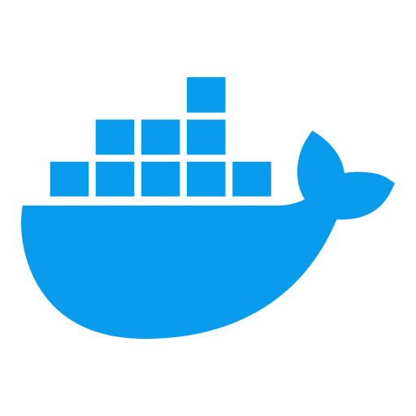

# 👋 Hi there

<picture>
  <source
    media="(prefers-color-scheme: dark)"
    srcset="https://raw.githubusercontent.com/lava-xa/lava-xa/output/github-contribution-grid-snake-dark.svg"
  />
  <source
    media="(prefers-color-scheme: light)"
    srcset="https://raw.githubusercontent.com/lava-xa/lava-xa/output/github-contribution-grid-snake.svg"
  />
  
</picture>

🤗 欢迎来访

你好！ 我是 lava ⭐️

  
  &nbsp;&nbsp;&nbsp;
  
  &nbsp;&nbsp;&nbsp;
  
  &nbsp;&nbsp;&nbsp;
  
  &nbsp;&nbsp;&nbsp;
  

